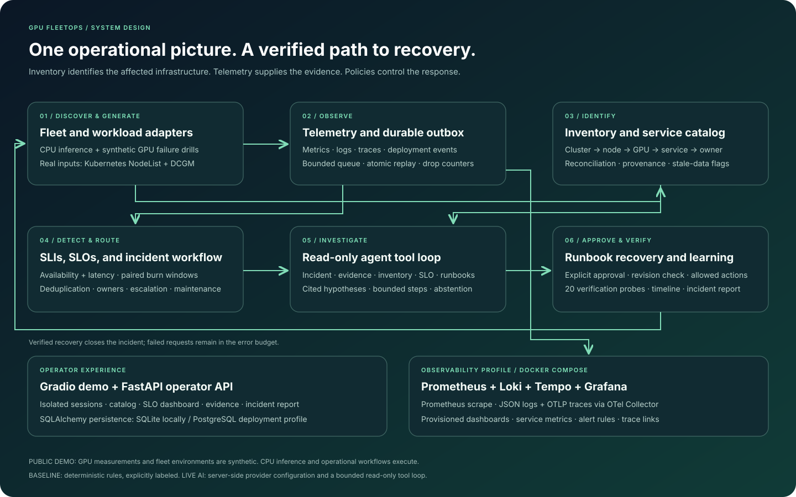
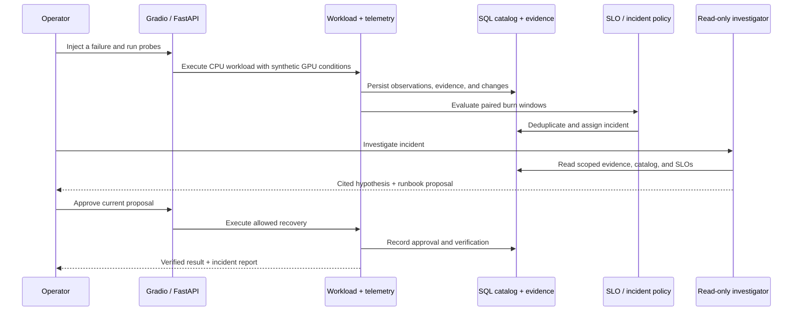

# Architecture

## Request path

Gradio and the operator API call the same `FleetOps` service. Each session has a `Lab`, an inventory reconciler, and a database namespace. The lab executes CPU inference and persists an observation. Logs, traces, changes, and catalog discrepancies become evidence with IDs. A detector evaluates objectives and creates or updates an incident. Investigation reads scoped context. Approved recovery performs a finite simulation action and verifies the result.

## Data model

| Entity | Fields and relationships |
|---|---|
| Asset | Stable ID, kind, parent, environment, owner, service IDs, desired/observed driver, source, observed time. |
| Service | Owner, escalation target, dependencies, runbook. |
| Observation | Session, request, service, time, status, reported latency, actual CPU time, trace ID, source. |
| Evidence | ID, service, kind, source, time, diagnostic attributes, trace ID. |
| Incident | Fingerprint + service, state, owner, evidence IDs, alert count, detection/resolution times. |
| Proposal | Action, evidence, change/incident revisions, approval/execution state. |
| Timeline | Incident, event, time, operator/action where applicable. |

SQLAlchemy stores versioned entity documents in a composite-key table `(namespace, kind, id)`. Observations have a dedicated typed table and window index `(namespace, service, timestamp)`. SQLite and PostgreSQL share this schema. A larger deployment should normalize relationships, enforce database foreign keys, and add explicit schema migrations.

## Consistency

Discovery rejects unknown parents/services. Older snapshots cannot overwrite newer ones. Source precedence is `manual > dcgm > kubernetes > seed`. Owner conflicts are recorded; equal-time conflicts preserve current ownership. Empty discovery ownership preserves an existing owner. Desired drivers remain separate from observed drivers. Stale and unowned records are visible.

An incident starts with its service owner. A validated diagnosis can route it to the dependency or infrastructure owner in its runbook. Escalation records are local; no external paging service is contacted.

## Failure boundaries

- A simulated collector outage diverts evidence into a persistent outbox capped at 1,000 records/session.
- An independent control-plane signal describes the outage.
- Replay moves evidence and deletes queued records in one transaction; repetition creates no duplicates.
- Overflow drops new telemetry and increments a metric. Local request metering still supports SLIs.
- The external OTel pipeline has separate persistent exporter queues.
- Recovery checks incident and configuration revisions. Repeated/stale plans are rejected.
- Failed verification leaves an incident active. Recovery preserves historical failures.
- Historical burn alone cannot reopen a verified incident; a fresh unhealthy batch is required.

## Public demo boundaries

Gradio stores session IDs in server-side state. Every database access includes the namespace; public callbacks cannot choose another session. The operator API requires a bearer token and is disabled without one. Secrets stay out of Gradio config and reports. Public inputs cannot fetch URLs, execute shell commands, or mutate real hardware.

There are at most 128 active sessions, one-hour idle expiry, 2,000 probes and 30 investigations per lab, a finite Gradio queue, and a separate server-wide live-provider quota. The default demo has no paid model dependency.

## Scaling tradeoffs

The application runs one process. In-process locks and optimistic revisions protect the current workflow. Multiple workers require database-enforced incident uniqueness, distributed session coordination, transactionally claimed recovery plans, and an external worker queue. PostgreSQL alone does not establish those guarantees.

Large fleets need collectors close to hardware, common resource IDs, bounded metric labels, durable transport, scalable storage, and retention. Measure catalog latency, telemetry throughput/loss, and triage quality independently. A replay of 1,000 logical GPUs does not prove operation of 1,000 physical GPUs.

## Modules

`lab.py`: workload and response. `inventory.py`: discovery. `slo.py`: reliability math. `agent.py`: model/tool boundary. `store.py`: persistence. `telemetry.py`: instrumentation. `api.py` and `ui.py`: two interfaces to one service.
