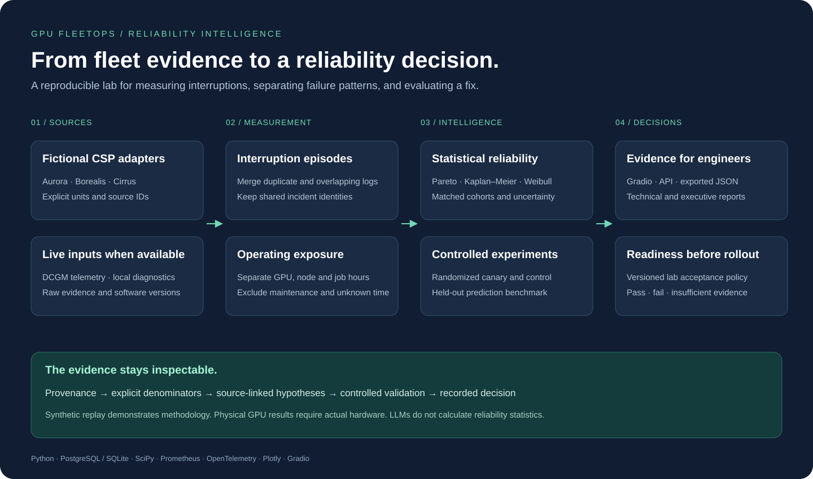

# Architecture

## Components

`contracts.py` defines validated entities, exclusions and interruption events. `adapters.py` translates three fictional source shapes into that common contract. These names are lab formats, not AWS, Azure or GCP integrations.

`analysis.py` reconciles episodes, computes exposure, preserves source IDs, compares cohorts, and produces candidate explanations. `statistics.py` contains the rate, survival, confidence-band and censored Weibull calculations. No LLM participates in those calculations.

`simulation.py` generates a reproducible fleet and independent follow-up period. Ground truth is returned separately and is never passed to the analyzer. Explicit GPU, node and job schedules preserve distinct denominators.

`prediction.py` trains an actual logistic model in NumPy, selects a threshold on validation data, and compares it with rules on held-out devices/provider/time. Its inputs and target are a separate synthetic snapshot dataset.

`readiness.py` evaluates a versioned lab policy and offers an opt-in local `dcgmi` subprocess. Its legacy JSON adapter fails closed for unknown result shapes. It never runs commands from Gradio or remote request text.

`reporting.py` creates machine-readable evidence and two audiences' reports. `views.py` plots those same values in Gradio. The operator API persists the last replay in the existing namespace-isolated SQL store; the public UI computes bounded synthetic reports without retaining user data. PostgreSQL and SQLite share the store contract.

## Original FleetOps integration

Inventory, request SLIs/SLOs, incident ownership, durable telemetry, and approved simulated recovery remain available. Existing DCGM metric ingestion and Kubernetes inventory reconciliation remain operator-authenticated. Their current-value telemetry does not by itself provide the historical interruption/exposure contract needed for fleet MTBI.

The existing optional LLM investigator can retrieve evidence and propose allowlisted simulation actions. Statistical reliability review is deterministic. This keeps numerical results reproducible while retaining the earlier agent workflow.

## Observability and limits

Prometheus adds completed replay count, replay duration, and the latest synthetic interruption/exposure/unknown totals. Labels have bounded values; source event IDs and GPU IDs do not become labels on the new reliability metrics. An OpenTelemetry `reliability.replay` span and a structured completion log carry provenance and fleet size.

The app is a bounded reference implementation with one application worker, not a distributed fleet analytics backend. Public replay size is capped at 1,500 logical GPUs and two concurrent runs. Authenticated canonical imports allow up to 5,000 entities and 50,000 events. Production work would require streaming ingestion, durable partitions, strict tenant boundaries, late-event policy, data retention, cohort changes over time and customer-agreed statistical standards.
