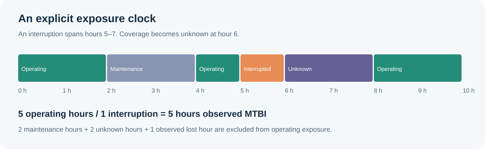

# Measurement contract v1.0

## Agree on the unit first

An **interruption** is observed loss of an entity's ability to continue its assigned work. A warning or Xid record alone is not an interruption. A source must explicitly supply `interrupted: true`, with an onset and recovery time.

| Unit | Observation schedule | Interruption episode |
|---|---|---|
| GPU | Explicit GPU observation start/stop | One contiguous observed GPU outage |
| Node | Explicit node observation start/stop | Loss of required node capability |
| Job | Explicit job execution observation start/stop | A job's work is interrupted |

GPU-hours are never silently converted into node-hours or job-hours. The simulation explicitly schedules one persistent job per node; any member-GPU interruption interrupts that synthetic node/job. Real job adapters need actual placement and lifecycle records. The same cooling incident can affect many GPUs and jobs: shared incident counts and entity-episode counts answer different questions.

## Exposure and exclusions

All numeric times are **hours from the dataset's UTC epoch**. Observation windows are half-open `[start, stop)`. Every event and exclusion must be inside its entity's observation. Provider B's fictional seconds are divided by 3,600 on input.

`operating_hours = scheduled_hours - union(maintenance, unknown, observed interruption downtime)`

`observed MTBI = operating entity-hours / interruption episodes`

This is an inverse interruption-intensity estimator for the defined cohort. It is not mean job completion time or a universal hardware lifetime. If no interruptions occur, the point MTBI is `null`, with a finite lower confidence bound and an unbounded upper limit. No exposure produces `no_data`.

Unknown coverage does not become healthy time. Planned maintenance is excluded from this hardware-interruption metric; the original request-based SLO policy separately keeps failed requests during maintenance. An interruption beginning inside maintenance or unknown coverage is excluded because its onset is not observable under this policy. An observed outage extending into an unknown interval contributes only its observed downtime.

## Event reconciliation

- Exact source-ID duplicates are idempotent. Conflicting payloads sharing an ID are rejected.
- Same-entity/same-incident records merge when overlapping or separated by at most 30 seconds.
- A reused key separated by a larger gap remains a separate outage.
- Overlapping interruption windows on one entity merge even when source incident keys differ. Their keys are retained, and multi-domain attribution becomes `unknown`.
- Warnings do not consume interruption exposure or create episodes.
- Invalid references, timestamps, non-finite numbers, or unknown units fail validation.

Lost GPU-hours are the union of observed downtime, excluding maintenance and unknown intervals. They do not include checkpoint replay, retraining, queueing, or unobserved lost useful work. Pareto attribution sums to the same total; ambiguous multi-domain episodes remain visible as unknown.

## Statistical interpretation

Rate intervals use exact Poisson count bounds divided by operating exposure. Inverted bounds describe the inverse rate. The model assumes constant intensity and independent episodes. Shared cooling or rack failures violate independence: intervals are descriptive and can be optimistic. Do not use them for a production release decision without an appropriate clustered/recurrent-event model.

Kaplan–Meier estimates **time to first interruption**, with maintenance pausing the operating clock. First unknown coverage right-censors that entity at the gap's onset; events after that gap do not retroactively create a first-event observation. Known-healthy devices contribute right-censored time. Tied failures are processed before tied censoring. Pointwise bands use Greenwood variance and a log-log transform.

Weibull fitting uses SciPy's censored-data likelihood with location fixed at zero. It requires at least eight positive failures and four distinct failure times. The reported maximum gap from KM is a descriptive fit diagnostic, not a calibrated goodness-of-fit test. Pooled device types, environments, competing failure modes, and informative censoring can invalidate the model; inspect homogeneous cohorts before interpreting shape as aging.

Driver comparisons standardize over common strata of provider, rack, model, firmware/configuration, workload and age band. Unmatched strata are excluded and matched exposure is reported. Both all-cause and software-domain comparisons are available. Exploratory hypothesis rules use software-domain evidence for a driver pattern. Residual confounding remains; a candidate explanation requires controlled validation.

References: [NIST reliability analysis](https://www.itl.nist.gov/div898/handbook/apr/section4/apr413.htm), [SciPy censored data](https://docs.scipy.org/doc/scipy/reference/generated/scipy.stats.CensoredData.html), [NVIDIA Xid interpretation](https://docs.nvidia.com/deploy/xid-errors/analyzing-xid-catalog.html).
