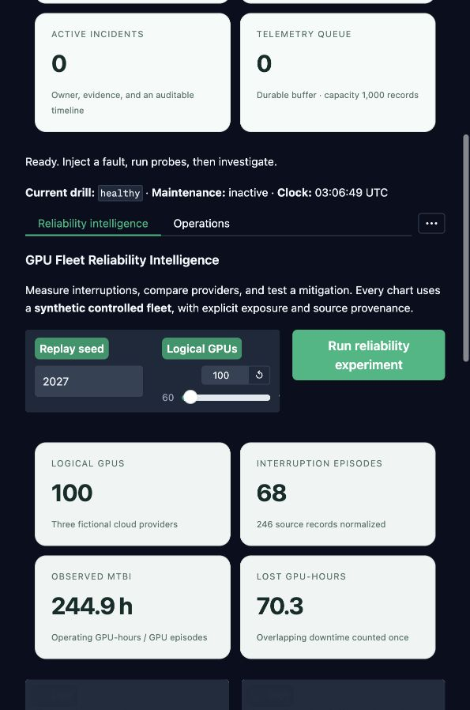
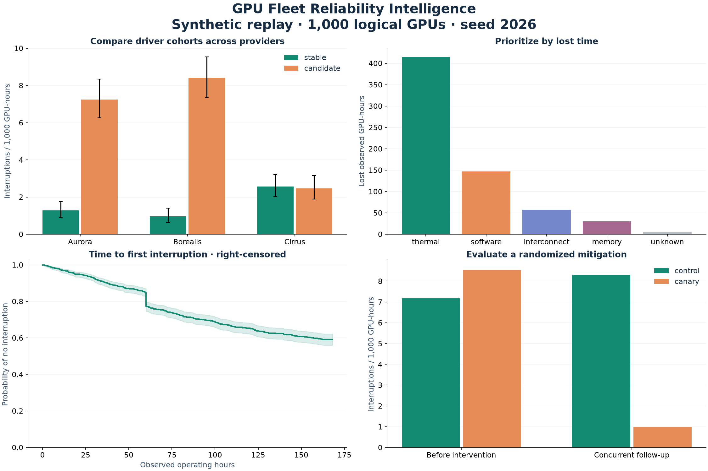

# GPU Fleet Reliability Intelligence

A practical guide to the reliability extension of GPU FleetOps.


## Start in five minutes

From the repository root, with Python 3.12 or 3.13:

```bash
python -m venv .venv
source .venv/bin/activate
pip install -r requirements-dev.txt
pip install --no-deps -e .
fleetops
```

Open http://127.0.0.1:7860. The first tab is **Reliability intelligence**. It loads a calculated replay of 1,000 logical GPUs across three fictional CSPs. Change the seed or fleet size and select **Run reliability experiment**.

1. Compare driver interruption rates across providers.
2. Read the candidate explanations and the evidence limitations.
3. Inspect lost time and survival through the common observation period.
4. Compare randomized canary and concurrent control outcomes.
5. Expand predictive health, readiness examples, and the technical review.
6. Use the Operations tab for the original incident investigation and approved simulated recovery.

No GPU, paid cloud account or LLM key is needed for this replay.



The capture above is the running local application after changing the seed and fleet size. It shows 100 logical GPUs and 68 interruption episodes for that replay.

## Reproduce the evidence

```bash
fleetops-reliability replay --seed 2026 --assets 1000 --output reports/reliability
pip install -r requirements-figures.txt
python scripts/reliability_figures.py
```

The replay writes a complete JSON evidence bundle, a classification evaluation, a technical review, and an executive brief. Matplotlib exports scientific figures as SVG and PNG. Measured runtimes and hashes are saved with the evidence; other machines will have different runtimes.



## What to read next

| Question | Guide |
|---|---|
| What exactly does MTBI measure? | [Measurement contract](MEASUREMENT.md) |
| How does the system fit together? | [Architecture](ARCHITECTURE.md) |
| How are the failures and mitigation evaluated? | [Experiments](EXPERIMENTS.md) |
| How does the prediction benchmark avoid leakage? | [Predictive health](PREDICTION.md) |
| How do I use a real supported GPU? | [Hardware readiness](HARDWARE.md) |
| How do I automate analysis? | [API and data contracts](API.md) |
| Which scenarios are covered? | [Use cases](USE_CASES.md) |
| What actually ran? | [Verification](VERIFICATION.md) |
| What should an independent engineer review? | [Review checklist](REVIEW.md) |
| How does this relate to the NVIDIA role? | [Portfolio narrative](PORTFOLIO.md) |

The public default uses synthetic fleets and authored readiness fixtures. Live source adapters establish an integration only after actual hardware validation. A short readiness test cannot establish long-term MTBI.
